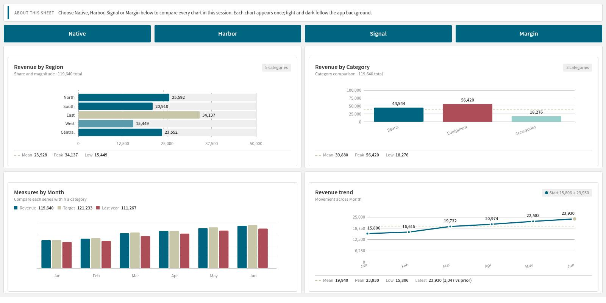

# Build your first view

Tm Custom Visualisation is for dashboard authors who need a custom card, list, infographic or scene. It uses the dimensions and measures you add in Qlik. If a native chart already fits, it is usually quicker to set up and brings Qlik's own export and accessibility features.

1. Edit a sheet and add Tm Custom Visualisation from the custom objects.
2. Under Data, add one dimension and one measure, for example Region and Sales.
3. Open Template, choose Baseline bars under Preset and choose Load preset. Read the preset's field-order guidance: your field labels can be different.
4. Choose a Style independently of the preset. Changing Style keeps your HTML and CSS; Load preset replaces them.
5. Leave edit mode and select a region in the chart. Confirm the pending selection with the green tick in the object's Qlik toolbar.

## Make it your own

Edit HTML and CSS in the panel. Templates insert escaped field values, repeat rows, test conditions and group data. Helpers cover numbers, arithmetic, comparisons, totals, shares, text, cumulative values and viewport dimensions. Selection and tooltip helpers provide keyboard interaction. Sheet navigation works in the Qlik client outside edit mode and is not shown in snapshots.

Use Template source expressions to take HTML and CSS from app variables when several objects should share one template. Create app variables before using them. Use the native Styling panel for fonts and appearance, and template CSS for your layout. Custom templates remain your responsibility for layout, data meaning and accessibility.

Read [Layouts and styles](layouts-and-styles.md), [AI and author scripts](ai-and-scripts.md) and [Requirements and limits](good-to-know.md) before building a larger view.
