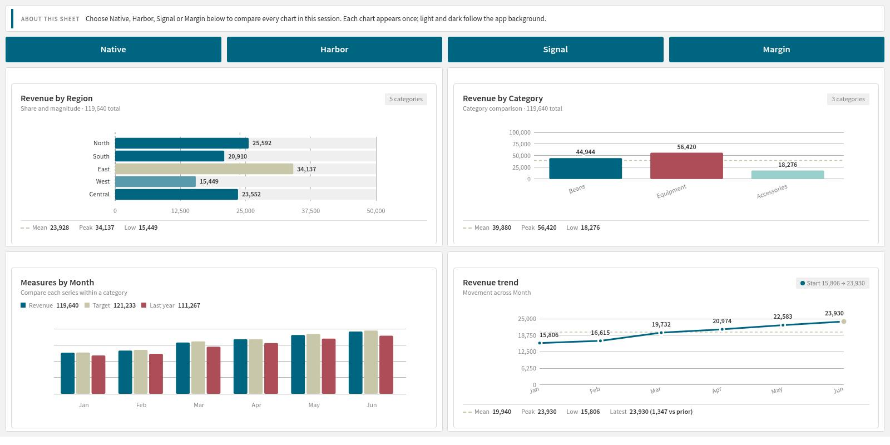
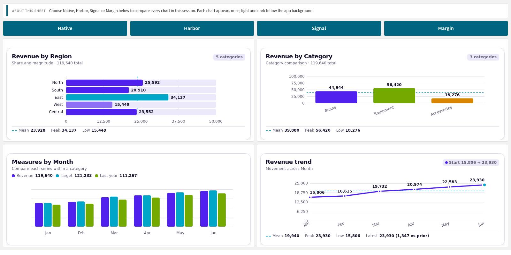
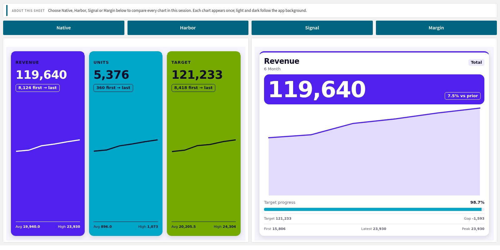
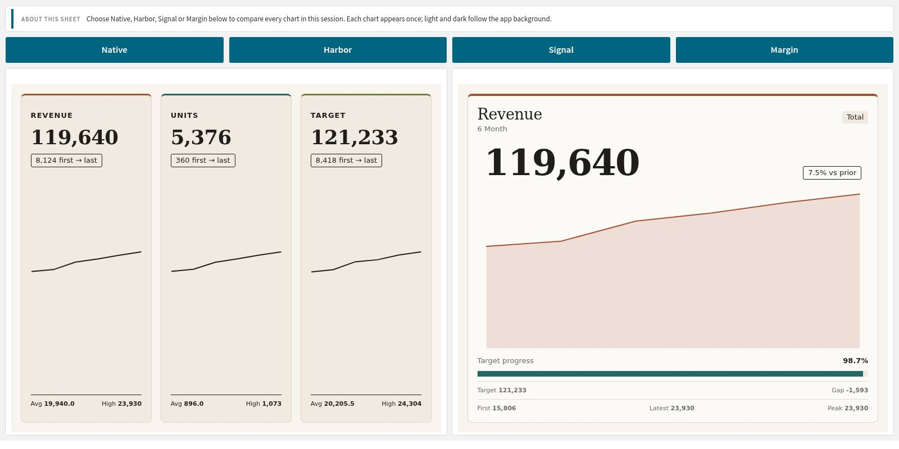
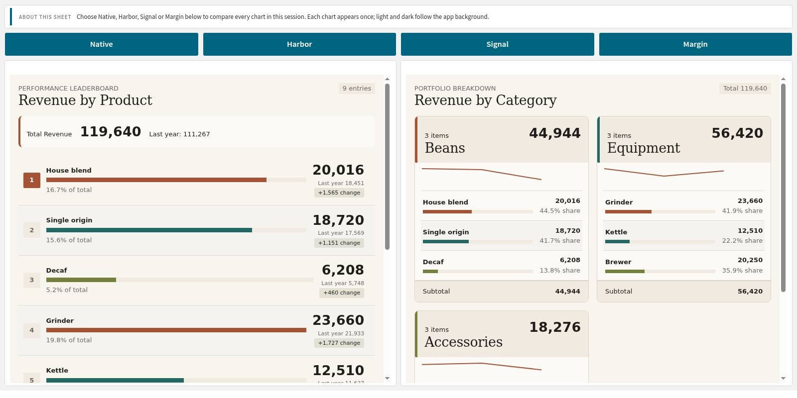
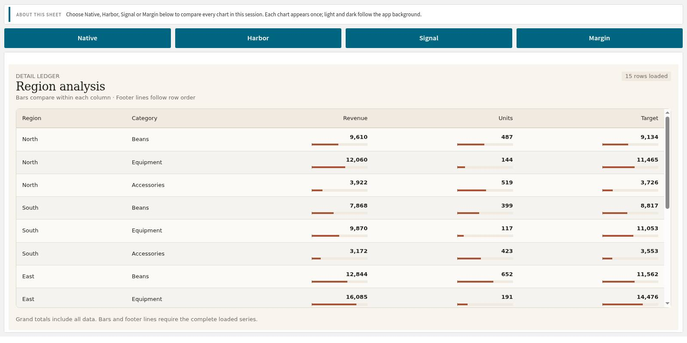
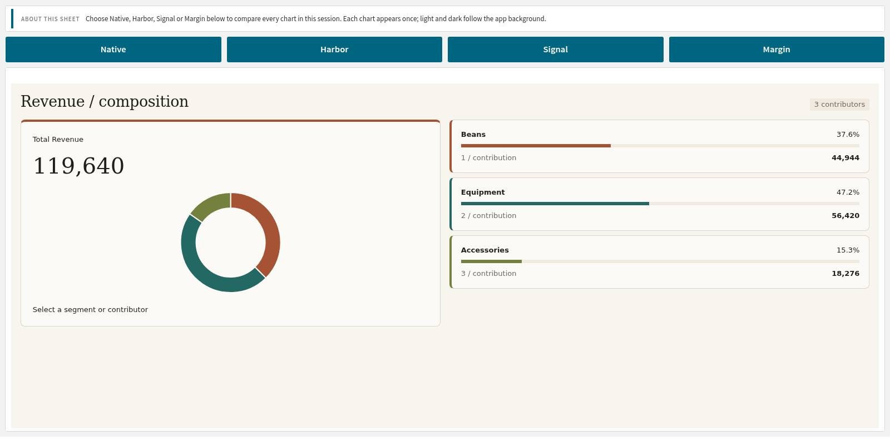

# Choose a layout, then its style

The Studio has 22 chart, card and list types:

- Baseline bars, columns, grouped columns, line trend, area trend, donut share and scatter plot.
- Actual vs target, sparkline rows, heat map, funnel, gauge rings, waterfall and treemap.
- KPI strip, hero KPI, ranked list, action cards, status tiles, grouped list, table and glossary.

Four infographic briefings add mix analysis, delivery performance, a unit dot matrix and a performance atlas. A blank starter lets you begin with your own markup. Each preset explains the field order it needs. Match that order and sort time or sequence dimensions appropriately. Loading a preset replaces the current HTML and CSS.

## Four styles for the same data

Style is independent of the preset. Native (shown as Qlik native in the picker) follows the active Qlik theme; Harbor uses calm blues; Signal has vivid accents and bold cards; Margin has warm surfaces and serif headings. Light and dark follow the app background automatically. Changing Style keeps the saved template.









## Share a style across objects

Create the app variable `vTmStyle` and give it one of these values: `native`, `harbor`, `signal` or `margin`. In each object's Style expression, enter:

```qlik
=If(Len(Trim(vTmStyle))>0, vTmStyle, 'native')
```

Use Qlik action buttons to change the variable in analysis mode, as the demo does. This needs no author script. Create the variable first; absent-variable behavior still needs hosted verification. A blank Style expression uses the picker. The expression above explicitly falls back to Native for empty variable text; unknown style names also fall back to Native.

Optional layout classes and validated design tokens support custom compositions, shared custom token sets and per-object overrides. Plain HTML and CSS also work. Native approximates Qlik styling; it does not reproduce every native chart's CSS or load external fonts. Fonts must already be available in the browser. Automatic plot, axis, grid and legend macros are not available.

## Lists and detailed views

Use ranked lists for comparisons, grouped lists for category totals and shares, or a table with a paged loop for detail. A glossary can page by initial-letter groups. Review the preset's expected measures, units and thresholds before using it with your own data.





## Infographics

Mix briefing combines a selectable donut, total, share ledger and contribution bars. Delivery briefing shows days against a promise where lower is better; edit its thresholds and scale for your use case. Unit dot matrix uses one dot per 100 units, rounded to the nearest hundred. Performance atlas combines group totals, sparklines and labelled period tiles. These presets need the field order and measure types shown in the panel.


